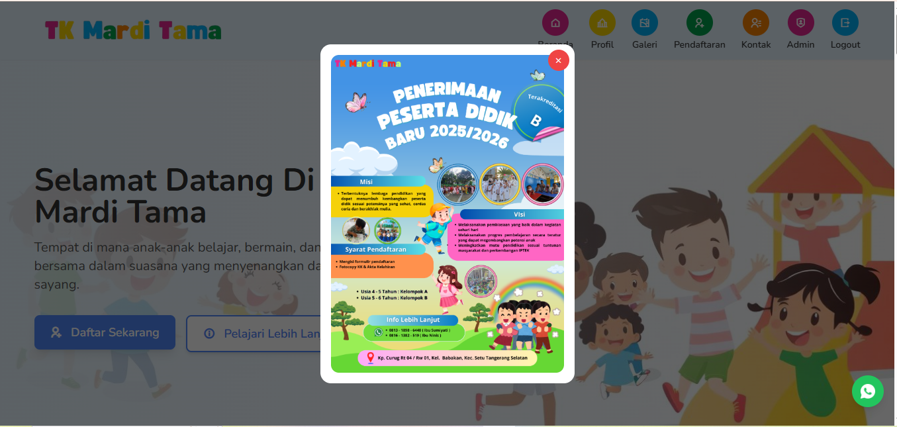
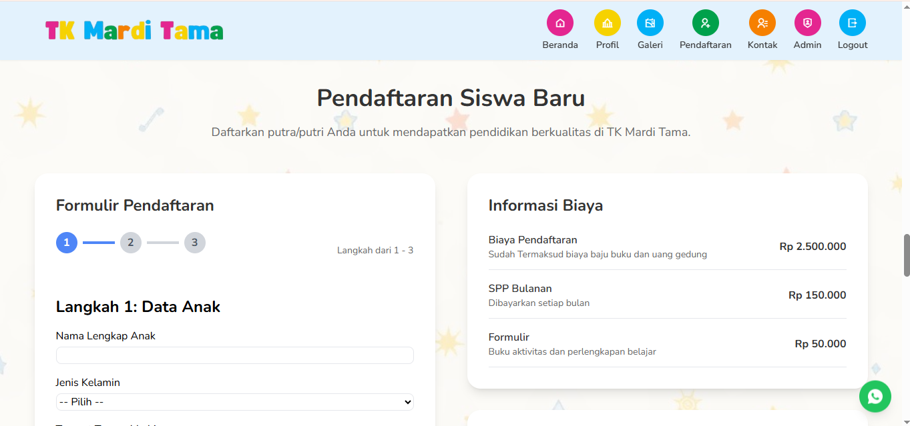
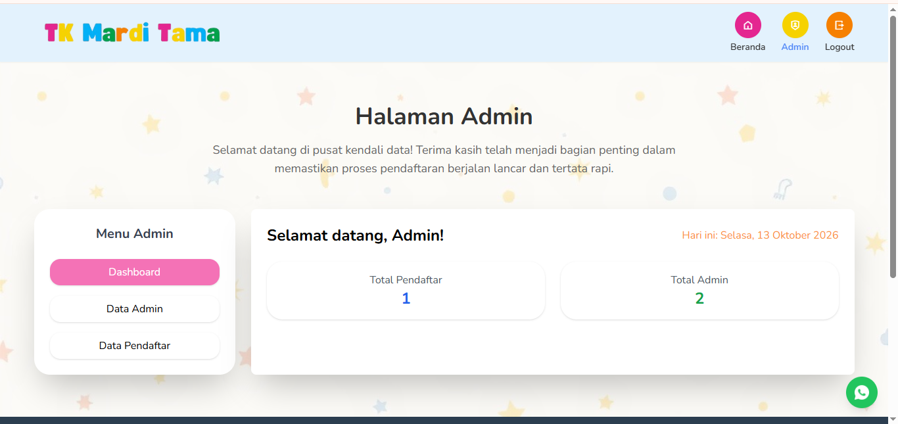

# 🎓 PPDB TK Mardi Tama

Aplikasi web Penerimaan Peserta Didik Baru (PPDB) untuk TK Mardi Tama. Aplikasi ini membantu calon orang tua siswa memperoleh informasi sekolah dan mendaftar secara online.

Dibangun dengan **Laravel**, **Blade Template**, **CSS**, dan **JavaScript**, dengan fokus pada kemudahan penggunaan, tampilan responsif, dan struktur kode yang mudah dipelihara.

---

## 📸 Preview Aplikasi

### Halaman Utama
<p align="center">
  
</p>

### Formulir Pendaftaran
<p align="center">
  
</p>

### Halaman Admin
<p align="center">
  
</p>

---

## ✨ Fitur Utama

- **Beranda**: informasi utama dan pengenalan sekolah.
- **Profil Sekolah**: informasi mengenai sekolah.
- **Galeri Kegiatan**: dokumentasi kegiatan dengan filter kategori.
- **Formulir Pendaftaran**: formulir PPDB dengan beberapa langkah pengisian.
- **Informasi Pendaftaran**: biaya dan alur pendaftaran.
- **Kontak Sekolah**: informasi kontak dan akses WhatsApp.
- **Navigasi Responsif**: menu untuk desktop dan perangkat mobile.
- **Tanggal Hari Ini**: tanggal ditampilkan pada halaman.
- **Popup Poster**: poster informasi sekolah.

---

## 🛠️ Teknologi

| Teknologi | Kegunaan |
|---|---|
| PHP | Bahasa pemrograman backend |
| Laravel | Framework aplikasi web |
| Blade Template | Template halaman |
| HTML | Struktur halaman |
| CSS | Styling dan tata letak |
| JavaScript | Interaksi frontend |
| Git | Version control |

---

## 📂 Struktur Proyek

```text
project-ppdb/
├── app/
├── public/
├── resources/
│   ├── css/
│   │   ├── app.css
│   │   └── ppdb.css
│   ├── js/
│   │   ├── app.js
│   │   ├── main.js
│   │   └── ppdb.js
│   └── views/
│       ├── layouts/
│       │   └── app.blade.php
│       ├── partials/
│       │   ├── navbar.blade.php
│       │   └── footer.blade.php
│       └── ppdb/
│           └── index.blade.php
├── routes/
│   └── web.php
├── docs/
│   └── screenshots/
│       ├── homepage.png
│       ├── gallery.png
│       └── registration.png
├── .env.example
├── composer.json
├── package.json
└── README.md
```

---

## 🧹 Refactoring Frontend

Struktur frontend dirapikan agar kode lebih mudah dibaca dan dikembangkan:

- CSS dipisahkan dari file Blade ke stylesheet tersendiri.
- JavaScript halaman PPDB dipisahkan ke `ppdb.js`.
- JavaScript navigasi dan interaksi antarmuka dikelompokkan di `main.js`.
- Event listener diinisialisasi dengan `DOMContentLoaded`.
- Logika navbar, menu mobile, dan filter galeri dikelompokkan.
- Logika tampilan tanggal dipisahkan dari template Blade.
- Navigasi formulir pendaftaran dan popup poster tetap berfungsi.

---

## 🚀 Instalasi dan Menjalankan Proyek

### 1. Clone repository

```bash
git clone https://github.com/muhamadzulsaban/ppdb-tk-mardi-tama.git
cd ppdb-tk-mardi-tama
```

### 2. Instal dependensi backend

```bash
composer install
```

### 3. Siapkan environment

```bash
cp .env.example .env
php artisan key:generate
```

Pada Windows, `.env.example` juga bisa disalin manual menjadi `.env`.

### 4. Konfigurasi database

Sesuaikan pengaturan di file `.env`, lalu buat database dengan nama yang sama:

```dotenv
DB_CONNECTION=mysql
DB_HOST=127.0.0.1
DB_PORT=3306
DB_DATABASE=nama_database
DB_USERNAME=root
DB_PASSWORD=
```

### 5. Jalankan migrasi

```bash
php artisan migrate
```

### 6. Instal dependensi frontend

```bash
npm install
npm run dev
```

Untuk build produksi:

```bash
npm run build
```

### 7. Jalankan aplikasi

```bash
php artisan serve
```

Buka `http://127.0.0.1:8000` di browser.

---

## 🧪 Checklist Pengujian

- [ ] Halaman utama tampil dengan benar.
- [ ] Navigasi desktop dan mobile berfungsi.
- [ ] Filter galeri menampilkan kategori yang dipilih.
- [ ] Tanggal hari ini tampil.
- [ ] Formulir pendaftaran dapat berpindah langkah.
- [ ] Popup poster dapat ditutup.
- [ ] Tombol WhatsApp mengarah ke nomor yang benar.
- [ ] Validasi dan pengiriman formulir berjalan sesuai implementasi backend.
- [ ] Tidak ada error JavaScript di browser.

---

## 🔒 Keamanan

- Jangan mengunggah file `.env` ke repository publik.
- Jangan mencantumkan password database, API key, atau token rahasia.
- Lakukan validasi data pendaftaran di backend.
- Validasi tipe dan ukuran file jika formulir menerima unggahan dokumen.

---

## 🗺️ Rencana Pengembangan

- Meningkatkan validasi formulir pendaftaran.
- Menyempurnakan pengelolaan data pendaftar.
- Meningkatkan aksesibilitas dan pengalaman pengguna.
- Menambahkan pengujian otomatis untuk fitur penting.
- Mengoptimalkan performa halaman dan aset frontend.
- Melakukan deployment agar aplikasi dapat diakses online.

---

## 👨‍💻 Developer

**Muhamad Zul Sa'ban**

- GitHub: [@muhamadzulsaban](https://github.com/muhamadzulsaban)
- Repository: [ppdb-tk-mardi-tama](https://github.com/muhamadzulsaban/ppdb-tk-mardi-tama)